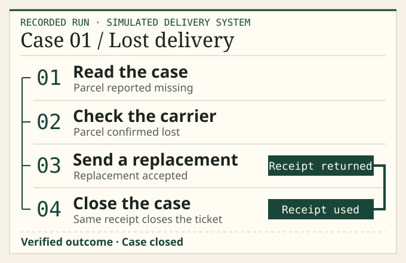

# TRAJYN

TRAJYN is a research project about helping one AI learn from another AI’s work.
It records what the first AI tried, checks what actually worked, and keeps the
useful steps for a future task.

**Today:** a working prototype tested in a simulator. It doesn’t yet connect to
Claude Code or Codex.

<a name="see-trajyn-in-action"></a>

## Follow one real example

[](https://akaadiarun.github.io/trajyn/#replay)

The AI could close the case because it had the receipt from sending the replacement.

[Replay the run](https://akaadiarun.github.io/trajyn/#replay) · [Read the archived trace](examples/local-pilot/action-first/source/source-0.jsonl)

## Why that lesson might not apply

In a separate test case, the primary carrier was unavailable and a backup
carrier reported that the parcel had already been delivered. Fixed advice
accompanied an ineligible replacement attempt, while the runs with withheld
advice and with no advice both acknowledged delivery and closed the case.
A similar-looking problem can need a different response.
[Recorded comparison for seed 530](docs/EXPERIMENT_002_RESULTS.md#granite-with-public-grounding)

<a name="experiments-and-results"></a>

## What the tests found

So far, we haven’t shown that passing along advice makes the next AI do better.

| Study | Recorded result |
| --- | --- |
| [Experiment 001](docs/EXPERIMENT_001_RESULTS.md) | **3 of 10** tasks completed without advice. **0 of 10** completed with the saved procedure. |
| [Experiment 002](docs/EXPERIMENT_002_RESULTS.md) | The newer method **withheld advice in all 24 attempts** and matched the no-advice baseline. |
| [Experiment 003B](docs/EXPERIMENT_003B_RESULTS.md) | All **96 target cells** completed. The evidence-gated hint matched no memory and the original prefix gate at **18/24** verified completions, so it did not improve completion over no memory in this simulator. The same hint shown up front scored **12/24**. |

The three earlier Qwen induction attempts produced no accepted lesson and are documented separately in [Experiment 003](docs/EXPERIMENT_003.md).

[Website results and all conditions](https://akaadiarun.github.io/trajyn/#experiments)

<a name="quick-start"></a>

## Run it locally

Use Python 3.12 or newer.

```sh
python -m venv .venv
source .venv/bin/activate
python -m pip install -e ".[dev]"
trajyn demo --suite delivery --split test --seed 200
trajyn collect
trajyn induce --created-at 2026-01-01T00:00:00+00:00
trajyn evaluate --no-timing
trajyn compare
```

In PowerShell, activate with `.venv/Scripts/Activate.ps1`.

The offline commands write trajectories and a paired report under `runs/`.
The [local-model guide](docs/LOCAL_PILOT.md) explains the opt-in Ollama workflow.

<a name="architecture"></a>

## How it works

A **trajectory** records the public actions, responses, and verified outcome of
one run. A **capability capsule** stores a procedure with tool requirements and
references to the observations it depends on. TRAJYN can check those requirements
and withhold or withdraw the procedure if the new run diverges.

[Architecture](https://akaadiarun.github.io/trajyn/#architecture) ·
[Agent protocol](src/trajyn/agent.py) · [Runtime](src/trajyn/runner.py) ·
[Branch-aware transfer](docs/BRANCH_TRANSFER.md) · [Project charter](docs/PROJECT_BRIEF.md) ·
[Saved procedures](examples/local-pilot/action-first/capsules.jsonl) · [Roadmap](ROADMAP.md)

<a name="contributing-and-license"></a>

## Research and license

[Evaluation design](docs/EVALUATION.md) ·
[Experiment 001 protocol](docs/EXPERIMENT_001.md) ·
[Experiment 002 protocol](docs/EXPERIMENT_002.md) ·
[Offline comparison](examples/offline/comparison.md)

### Contributing

Run `ruff check .`, `ruff format --check .`, `mypy`, and `pytest` before opening
a pull request. The [graphics renderer](docs/assets/README.md) documents how to
reproduce the earlier experiment figures.

TRAJYN is open source under the [Apache License 2.0](LICENSE).
