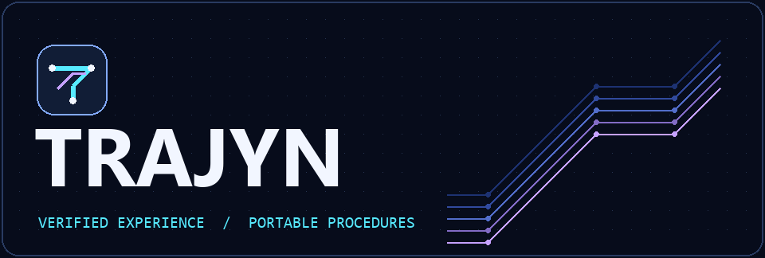
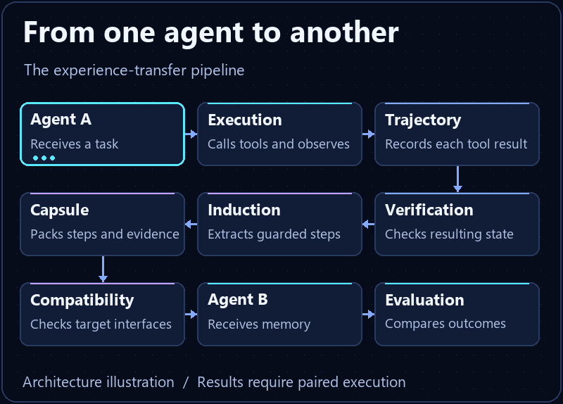
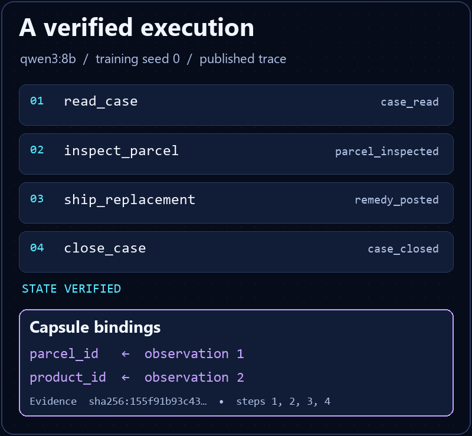
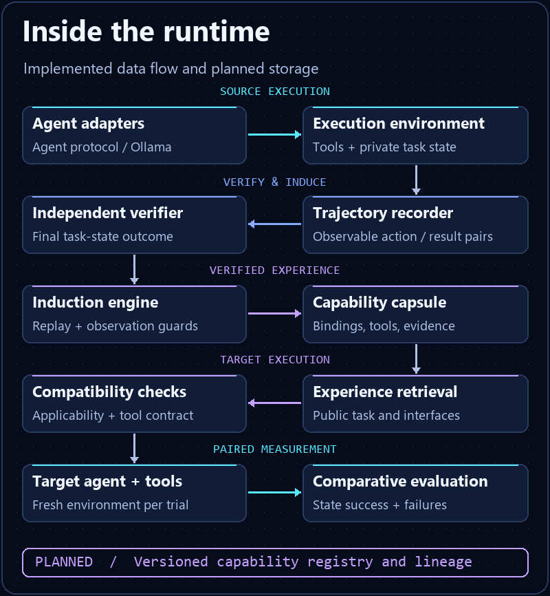
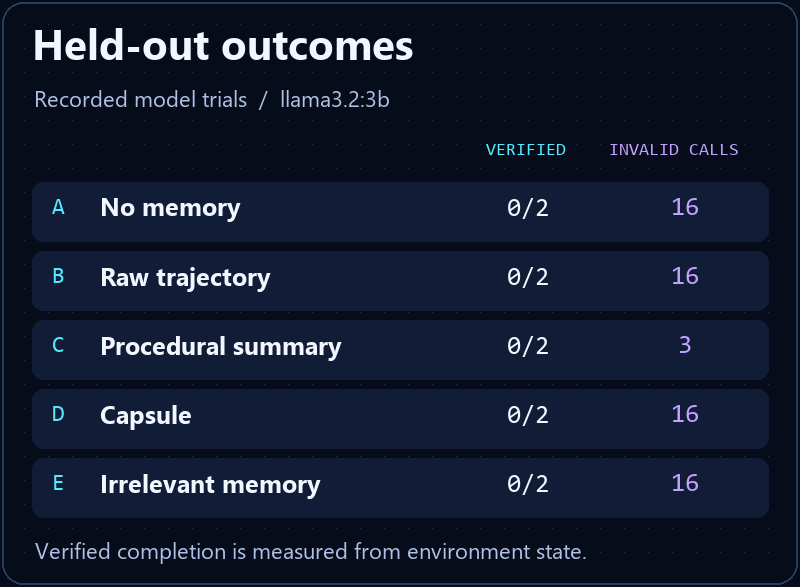

<p align="center">
  
</p>

<h1 align="center">The Experience Layer for AI Agents.</h1>

<p align="center"><strong>Experience is portable. Capability is earned.</strong></p>

<p align="center">
  <a href="https://github.com/akaAdiArun/trajyn/actions/workflows/ci.yml"></a>
  <a href="pyproject.toml"></a>
  <a href="LICENSE"></a>
  <a href="ROADMAP.md"></a>
</p>

<p align="center">
  <a href="#architecture">Architecture</a> ·
  <a href="#experiments-and-results">Experiments</a> ·
  <a href="docs/PROJECT_BRIEF.md">Documentation</a> ·
  <a href="ROADMAP.md">Roadmap</a>
</p>

TRAJYN is experimental infrastructure for turning a verified agent run into
a portable procedure that another agent can try. It records what the first
agent did, checks what actually changed, and packages the usable steps with
their evidence and tool requirements.

## Why TRAJYN?

Agents repeatedly solve related tasks in separate sessions, tool environments,
and model families. A transcript can show what happened on one task. To reuse
that experience, a different agent still needs to identify which steps apply,
where argument values come from, and what counts as success.

Suppose one agent resolves a lost delivery. TRAJYN can capture how it reads the
case, gets the parcel and product from the carrier, and uses the remedy receipt
to close the case. A second agent receives a procedure with those dependencies.
It supplies identifiers from its own task. A tool-interface check can reject a
warehouse procedure on a locker-only task.

## How it works



[Still diagram](docs/assets/pipeline.png) · [Evaluation protocol](docs/EVALUATION.md)

The animation illustrates the data flow. Performance is measured separately
through paired executions with the same target agent, tasks, tools, and budget.

## See TRAJYN in action



The dispatch arguments point to steps 1 and 2 in the source trace. The capsule
references that trace by content ID and records the supporting step indices.

[Original JSONL trace](examples/local-pilot/action-first/source/source-0.jsonl) · [Capsules](examples/local-pilot/action-first/capsules.jsonl)

## Architecture



The Python [agent protocol](src/trajyn/agent.py) separates model adapters from
execution. The runner passes the public task, tool interfaces, and observations
to the agent. The independent verifier reads resulting environment state.
Replaying a source trajectory checks each recorded observation before induction.

## Core concepts

| Concept | Role |
| --- | --- |
| Trajectory | Ordered public tool calls, observations, model identity, and verification outcome |
| Verified experience | A trajectory whose observable steps and final state can be replayed |
| Capability capsule | A versioned procedure with live bindings, observation guards, tool requirements, and evidence |
| Applicability and compatibility | Checks that the task and current tool interfaces can receive the procedure |
| Negative transfer | A paired regression against the same agent without memory |

## What works today

| Available | Status |
| --- | --- |
| Seeded tasks, state verification, JSONL replay | Implemented |
| Evidence-grounded induction and compatibility checks | Implemented |
| Offline and Ollama adapters, five-condition evaluation, CSV/JSON reports | Implemented |
| Reliable cross-model improvement | Research question |
| Capability registry, SDKs, and distributed exchange | Planned |

## Quick start

Use Python 3.12 or newer.

```sh
python -m venv .venv
# Activate with .venv/Scripts/Activate.ps1 on PowerShell.
# On macOS or Linux, run: source .venv/bin/activate
python -m pip install -e ".[dev]"
trajyn demo --suite delivery --split test --seed 200
trajyn collect
trajyn induce --created-at 2026-01-01T00:00:00+00:00
trajyn evaluate --no-timing
trajyn compare
```

The offline commands write trajectories and a paired report under `runs/`.
The [local-model guide](docs/LOCAL_PILOT.md) describes the opt-in Ollama path.

## Experiments and results



The offline fixtures verified **8/8** tasks in each condition. In the local
pilot, Qwen3-8B verified **4/4** source tasks and produced four capsules.
Llama 3.2 3B verified **0/2** held-out tasks in each condition. The small pilot
leaves cross-model transfer effectiveness open.

[Offline comparison](examples/offline/comparison.md) · [Local-model report and failed attempts](docs/LOCAL_PILOT.md) · [Recorded results](examples/local-pilot/action-first/evaluation/results.json)

## Roadmap

The [roadmap](ROADMAP.md) tracks retrieval, better controlled cross-family
studies, and future registry and SDK work. The [charter](docs/PROJECT_BRIEF.md)
defines the research questions and experimental controls.

## Contributing and license

See [AGENTS.md](AGENTS.md) for repository conventions. Run `ruff check .`,
`ruff format --check .`, `mypy`, and `pytest` before opening a pull request.
The README graphics have a [local renderer](docs/assets/README.md).

TRAJYN is open source under the [Apache License 2.0](LICENSE).
